# TailSplit

[](https://awesomemygo.dev/apps/tailsplit)

**Choose what stays direct and what goes through your Tailscale exits.**

TailSplit lets you use several Tailscale exits at once and choose a route for
each destination. Available as a desktop app for macOS and Windows, with a CLI
for macOS, Windows and Linux.

[Download](https://github.com/idy/tailsplit/releases/latest) · [Website](https://tailsplit.idy.dev/) · [Guide](docs/guide.md) · [Discord](https://discord.gg/RY7ktfh8Pr)



Exits can belong to the same or different Tailscale networks. Each exit uses its
own authorized Tailscale device.

## Why TailSplit?

- **Route by destination.** Keep some sites direct and send others through the
  exit you choose, using domain and IP rules.
- **Use multiple networks.** Route different destinations through different
  Tailscale exits without switching your whole computer between networks.
- **Start with ready-made rules.** Use built-in lists, import your own, or add
  exceptions in Settings.
- **Connect from the desktop.** Guided setup, a menu-bar or tray switch, and a
  live view of your routes keep everyday use out of configuration files.
- **Choose your mode.** Use rule-based routing for selected destinations, or
  Global mode to send all captured traffic through one exit.

## Get started

Download the latest package from [GitHub Releases](https://github.com/idy/tailsplit/releases/latest):

| Platform | Requirements | Downloads |
| --- | --- | --- |
| macOS | macOS 14+, Apple Silicon or Intel | Desktop app and CLI |
| Windows | Windows 10+ x64 or Windows 11 ARM64 | Desktop Setup EXE and CLI ZIP |
| Linux | amd64 or arm64 | CLI archive and `.deb` |

For desktop setup, you will need access to a Tailscale network with an exit node.

1. Open **Home → Set up** and follow the prompts to authorize a Tailscale device.
2. Choose an exit node and select **Save & connect**.
3. Open **Settings → Routing rules** whenever you want to change which
   destinations use each exit.

On macOS and Linux, you can also use the installer:

```sh
curl -fsSL https://tailsplit.idy.dev/install.sh | sh
```

It installs the desktop app on macOS or the CLI on Linux and verifies the
release's SHA-256 checksums. macOS also supports the
[Homebrew tap](https://github.com/idy/homebrew#install).
Windows executables are unsigned; verify the release checksums before installation.
See the [guide](docs/guide.md#install) for installer options and
[CLI setup](docs/guide.md#cli-configuration).

## Mobile

The [iOS and Android client](mobile/README.md) supports multiple signed-in
Tailscale networks with one selected exit at a time. See its README for setup
and current limitations. Mobile installers are separate from the desktop
packages above.

## Documentation

- [Desktop setup and configuration](docs/guide.md#macos-app)
- [Windows installation](docs/guide.md#windows-desktop)
- [CLI, DNS and rule sources](docs/guide.md#cli-configuration)
- [Updates and migration](docs/guide.md#desktop-updates)
- [Detailed desktop behavior](docs/desktop-reference.md)
- [Mobile setup and builds](mobile/README.md)

<details>
<summary>Building from source</summary>

Requires Go 1.27.3+ and Python 3.11+. macOS app builds also need Xcode Command
Line Tools and Swift. From the repository root:

```sh
make test check
```

See the [build guide](docs/guide.md#build-and-test) for running the desktop app,
platform-specific builds and additional checks.

The app and routing core live in `cmd/` and `internal/`; `site/` holds the public
website, and `packaging/` and `scripts/` contain installers and release tools.
Start with [config.example.yaml](config.example.yaml) for CLI configuration.
The Flutter client in `mobile/` uses one active Tailscale exit.

The [mobile app](mobile/README.md) uses `sing_box_flutter` for the system VPN and
implements Tailscale sign-in in Dart. It has native platform controls, English
and Chinese, and a separate mobile build workflow. iOS distribution is configured
for the LetSolo **TERMITOC PTE. LTD.** organization; see
[mobile CI and publication](mobile/docs/release.md) for credentials, capabilities
and the dual-identity IPA/TestFlight/App Store review workflow. Real-device VPN and signed store
publication remain separate verification steps; mobile installers are not part
of the desktop release assets above.

</details>

## Website development

The static public page lives in `site/` and needs no build step. `index.html`
loads the complete idy.dev SDK vendored in `site/shared/sdk/`, including its font
assets and licenses. Refresh that whole directory together; do not edit bundled
files individually. The Component Datasheet system uses self-hosted Archivo,
a blue masthead, white/deep navy sheets, 2px corners, fine rules and no shadows.
Local `styles.css` maps existing roles to `--idy-*` tokens while retaining the
routing diagram, rule ledger and platform downloads.

Run the website checks with `node --test tests/website.test.cjs`. Check both
languages and themes, narrow screens, the routing controls, code copying and
release failure/missing-asset states when changing the page.

## Community

Join [IDY Community on Discord](https://discord.gg/RY7ktfh8Pr) for questions,
routing examples and feature ideas. Use the **TailSplit** tag in the **ideas**
and **bug-reports** forums, or
[open a GitHub issue](https://github.com/idy/tailsplit/issues).

## License

[GPL-3.0-or-later](LICENSE). See [third-party notices](THIRD_PARTY_NOTICES.md).
